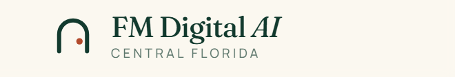

# Phase 1 — Design proposal

**Concept:** *The open door.* Warm editorial design with local roots: cream paper, deep
evergreen, terracotta, a serif with character and real photographs of people at work. The
opposite of the old neon-on-black software look.

The single idea behind every choice: an owner should feel that this studio is **nearby,
human and easy to talk to**, while the craft of the site itself proves the studio is good.

## 1. Positioning and the 5-second test

> FM Digital AI helps Central Florida businesses answer every call and message, fill their
> calendars and get found first — in English and Spanish — without hiring more staff.

The home page must answer three questions before a visitor scrolls:

1. **What is this?** A local studio that answers customers and fills schedules.
2. **Is it for me?** Clinics, restaurants, real estate, accountants, local services in
   Central Florida.
3. **What do I do next?** One action: the free audit.

The hero headline states the benefit in the owner's own words — *"Never lose a customer
because nobody answered"* — with the local and bilingual promise in the line below.

## 2. Colour palette

A light, warm palette with one dark section for contrast. Hex values are the source of truth
in `tailwind.config.js`.

| Token | Hex | Use | Contrast |
| --- | --- | --- | --- |
| Paper | `#FBF7F0` | Page background, light sections | Ink on paper **16.3:1** |
| Cream | `#FFFDF8` | Cards, form surfaces | Muted on paper **6.0:1** |
| Sand | `#F3EADD` | Alternating sections, marquee | Muted on sand **5.4:1** |
| Ink | `#161B18` | Primary text and headings | — |
| Muted | `#59615B` | Secondary text, captions | 5.4–6.0:1 on light surfaces |
| Forest | `#123A2E` | Dark sections, wordmark, links | Cream on forest **12.4:1** |
| Forest deep | `#0C2A20` | Footer | Cream on deep forest **15.1:1** |
| Clay | `#B24A2C` | **Primary CTA**, eyebrow dots, accents | White on clay **5.4:1** |
| Clay dark | `#8F371D` | CTA hover | — |
| Line | `#E4DACB` | Hairlines, card borders | Non-text |
| Gold | `#BE8B44` | Reserved accent tint | Non-text |
| Sage | `#DDE5DA` | Reserved supporting tint | Non-text |

**Why:** cream and evergreen read as established, trustworthy and local (banks, clinics,
family restaurants) without going beige-generic; terracotta gives the single action —
the free audit — an unmistakable, warm colour that is not the old neon. Every text pair used
for body-size copy meets WCAG AA; the only low-contrast elements are decorative.

## 3. Typography

| Role | Family | Details |
| --- | --- | --- |
| Display | **Fraunces** (variable, self-hosted) | Weights 400–600, optical sizing, italic used for emphasis. Warm, slightly literary, not corporate. |
| Body / UI | **Manrope** (variable, self-hosted) | Weight 450 base, 600–700 for labels and buttons. Geometric but humanist; excellent at 17px on mobile. |

- H1: `clamp(2.9rem, 6.2vw, 5.4rem)`, line-height 0.98, tracking −0.025em.
- H2: `clamp(2.3rem, 4.4vw, 3.9rem)`, line-height 1.02.
- Body: 17px / 1.65 (16px on small screens), max line length ~68 characters.
- Eyebrows: Manrope 600, 11px, uppercase, 0.19em tracking, with a clay dot.
- Fonts are self-hosted in `static/fonts/` (121 KB + 150 KB italic Fraunces, 25 KB Manrope,
  woff2, `font-display: swap`, preloaded). No Google Fonts request at runtime.

**Why:** Fraunces gives the site a point of view and keeps long headlines from feeling like a
dashboard; Manrope keeps forms, prices and body copy effortless on a phone. Both are
variable fonts, so the whole range costs two files per family.

## 4. Provisional logo

**Concept:** an open doorway drawn as a single rounded arch, with a terracotta doorknob.
The door is the local business; the open arch is the promise of answering, welcoming and not
turning anyone away. It is one colour plus one accent, reads at 16px in a favicon, and
matches the arched photography used through the layout.

- Component: `src/components/brand/Logo.tsx` (mark + wordmark, light and dark variants).
- Favicon: `static/favicon.svg`; touch icon: `static/apple-touch-icon.png`.
- Wordmark: "FM Digital **AI**" in Fraunces 600, with a small "Central Florida" line.
- Usage: forest on light surfaces, cream on forest; minimum mark width 24px; keep clear
  space equal to half the mark; never stretch, outline or add a glow.
- This is **provisional**; the owner reviews the definitive logo separately and it does not block
  the redesign.

## 5. Imagery

Real people at work, warm light, no robots, no code, no server rooms, no abstract tech.

| File | Subject | Source |
| --- | --- | --- |
| `hero-owner` | Smiling café owner behind her counter | Burst (Shopify) |
| `clinic-doctor` | Doctor with a clipboard in a bright office | Burst |
| `restaurant-kitchen` | Open restaurant kitchen during service | Burst |
| `real-estate-home` | Family house with a brick porch | Burst |
| `office-professional` | Business owner smiling at her desk | Burst |
| `barber-local` | Barber lining up a haircut | Burst |
| `owner-laptop` | Business owner reviewing orders on a laptop | Burst |
| `team-notes` | Colleagues working through a plan together (Home corporate section) | Burst |
| `studio-team` | Two team members working together at a laptop (About corporate section) | Burst |
| `shop-owner` | Local store owner in her shop | Burst |

- Burst photos are free for commercial use without attribution. They are self-hosted, not
  hot-linked, and were downloaded from the following source files:
  `smiling-cafe-owner.jpg`, `male-doctor-holding-clipboard.jpg`, `open-kitchen-restaurant.jpg`,
  `wooden-house-at-waters-edge.jpg`, `proud-business-owner-sits-and-smiles.jpg`,
  `barber-uses-clippers-to-line-up-hair.jpg`, `taking-notes-at-meeting.jpg`,
  `local-store-owner-stands-proud.jpg`,
  `business-women-talking.jpg`,
  `business-owner-working-on-online-store.jpg` (all on `burst.shopifycdn.com`).
- Each photo is delivered at 1600 px and 800 px in WebP (quality 82) with `srcset`/`sizes`;
  the largest (the real-estate house) is 366 KB at 1600 px, most are 30–150 KB.
- **Standardized, swappable slots.** Every image is rendered through `Photo`, which always
  fills a fixed-aspect, `object-cover` container defined by the slot (hero `4/5` arch, service
  hero `4/5` arch, About `4/5`, work cards `16/10`, sector tiles `square`, insight-agnostic
  team images `4/5`). Replacing a photograph is a one-file swap in `static/images/` with no
  layout work.
- Content images carry descriptive alt text in both languages; purely decorative images
  (supporting photos next to text that already explains the service) use an empty alt.
- The Aula Pro and ExpertPath screenshots from the old site were **not** reused: they are
  dark, technical-looking product shots and would fight the new direction.

## 6. Motion and interaction

Motion is used to make the page feel considered and expensive, never to delay reading.

- **Scroll-scrubbed video hero (desktop):** the Home hero is a 700vh track whose sticky stage
  pins for one viewport. Scroll progress scrubs a ~43 s dense-keyframe video — fetched as a
  streamed Blob behind a progress ring with the poster painting first, the displayed
  `currentTime` lerped toward the scroll target and seeks gated so they never overlap. Four
  caption beats crossfade in the calm left third over warm scrims, then the stage settles on
  the evolved-café frame with the H1 + CTA (copy from `copy.ts`). Transform/opacity only.
  Phones, tablets and reduced-motion visitors get a static settle frame and never fetch the
  video.
- **Word reveals and emphasis sweep:** section titles split into words that stagger in on
  entering the viewport; the accent phrase renders italic clay/cream with an underline that
  draws in behind it. A visually hidden plain-text copy keeps every heading correct for screen
  readers and search.
- **Floating feature cards:** the four service cards drift ±7 px on a slow, staggered 8 s loop
  (transform only), with the warm soft shadow travelling with them.
- **Entrance choreography:** paragraph, actions, proof row and image enter in a 50–120 ms
  stagger over 0.65 s (`cubic-bezier(0.22, 1, 0.36, 1)`).
- **Scroll reveal:** 22 px rise + fade, 0.65 s, triggered once per element; card grids use
  short delays so they read as one wave.
- **Image parallax:** ±24 px scroll-linked movement on the Home studio image, About hero and
  studio image, and service-detail image; page-hero headlines get a ±14 px parallax. Transform
  only, disabled under reduced motion.
- **Route transitions:** a 0.28 s fade/10 px rise between pages (`AnimatePresence`), disabled
  under reduced motion.
- **Glass surfaces:** frosted header on scroll, audit-form panel, service cards on the dark
  section, the studio quote card, the FAQ/help panels and the service-detail price panel — warm
  cream translucency with a soft white border and a solid fallback when `backdrop-filter` is
  unavailable. No dark or neon glass.
- **Accordion:** height/opacity 0.32 s; one open at a time; native button + `aria-expanded`.
- **Hover:** cards lift 1–4 px and gain a soft shadow, photos scale 3–4% over 0.9 s, arrows
  travel 2–4 px, and the primary CTA gets a single warm light sweep.
- **Reduced motion:** ambient drift, parallax, route transitions, reveals, CTA shine, hover
  transforms and the marquee are all disabled or static; content remains fully visible.
- No scroll-jacking, no parallax on text, no autoplay video, no modal on load, no layout
  animation.

## 7. Layout system

- Container: 1220 px max, 20 px gutters on phones, 32 px above 640 px.
- Rhythm: sections at 64 px on mobile, 96–112 px on desktop; alternating paper / sand /
  cream / forest to segment the page without boxes everywhere.
- Signature shapes: the **arch** (photos and hero), 1.5–2.75 rem radii, 1 px hairline borders
  and very soft warm shadows instead of glows.
- Reusable primitives: `Section`, `Container`, `SectionHeading`, `Eyebrow`, `Button`,
  `AuditButton`, `Photo`, `Parallax`, `FaqList`, `Reveal`, `ServiceCards`, `CtaBand`,
  `PageHero`, `AuditForm`.
- Every page ends with the same primary action: the free audit.

## 8. Accessibility

- One `<h1>` per page, ordered headings, skip-to-content link, landmarks, visible
  `:focus-visible` ring (clay, 2 px, 3 px offset).
- All form fields have labels, required fields are announced, errors use `role="status"` and
  `aria-live`; the honeypot is removed from the accessibility tree and the tab order.
- Mobile menu: `role="dialog"`, `aria-modal`, Tab/Shift+Tab trapped inside, Escape closes,
  background scroll locked, focus returns to the menu button.
- Language switch is two labelled buttons with `aria-current`; the `<html lang>` attribute
  follows the `/es` route.
- All contrast pairs used for text meet AA (see palette); decorative elements are marked
  `aria-hidden`.
- Reduced-motion support is global and per component, including the ambient hero, parallax
  and route transitions.

## 9. Owner-approved direction

1. The palette (cream / evergreen / terracotta) and the type pairing (Fraunces + Manrope) were
   approved to continue on 7 November 2026.
2. The corporate tone is approved: no founder persona, first-person quote, name or portrait on
   the public pages. Home and About speak as the studio ("we") with team-at-work photography.
3. The logo remains **provisional** for separate review.
4. Contact happens **only through the audit form**: no phone, email, street address or
   LinkedIn link.
5. The 30-minute audit and pricing wording were approved as quoted, with no changes.
6. The blog is external at `https://fmdigitalai.com/blog/`; the site only links to it.
